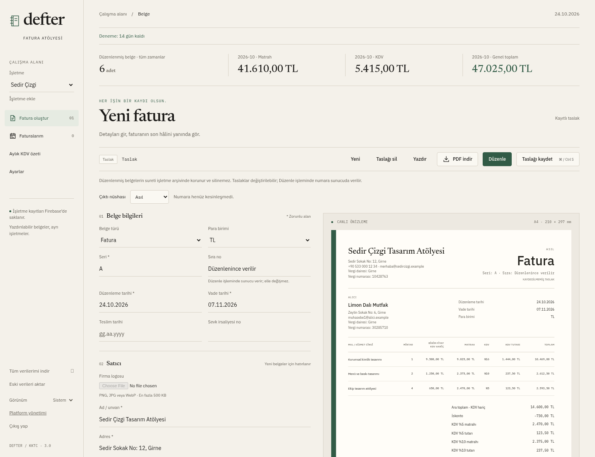
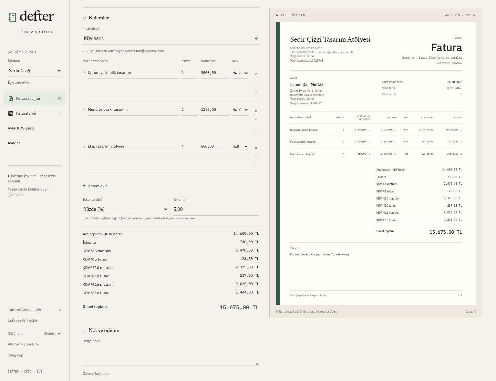
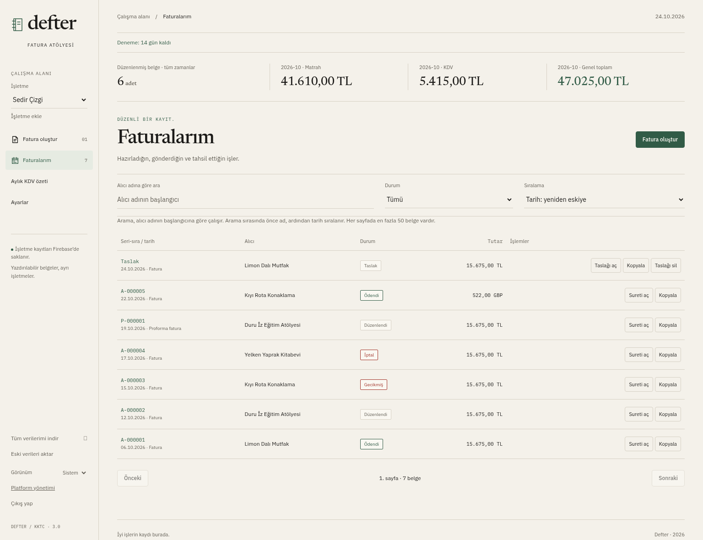
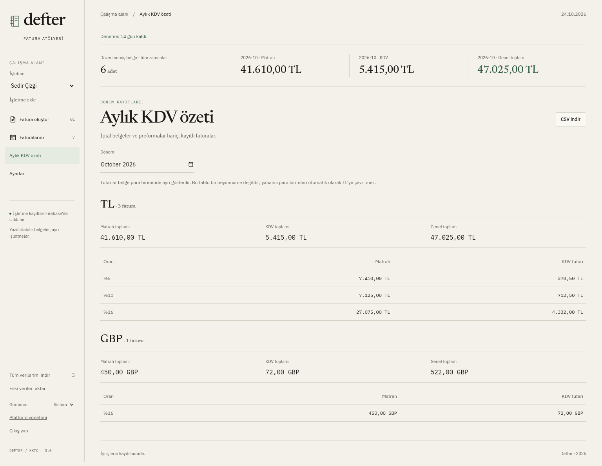
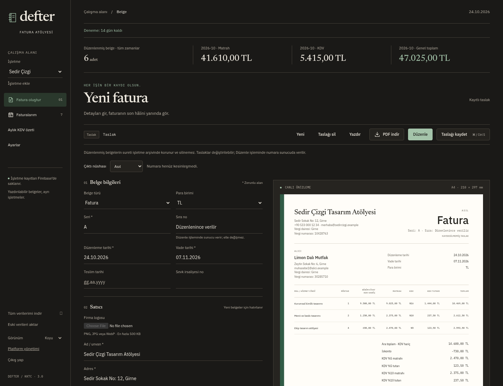
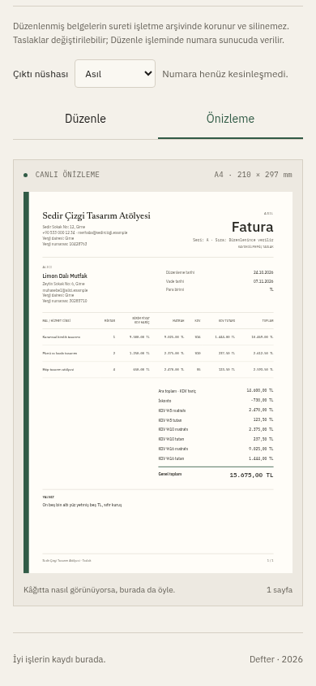
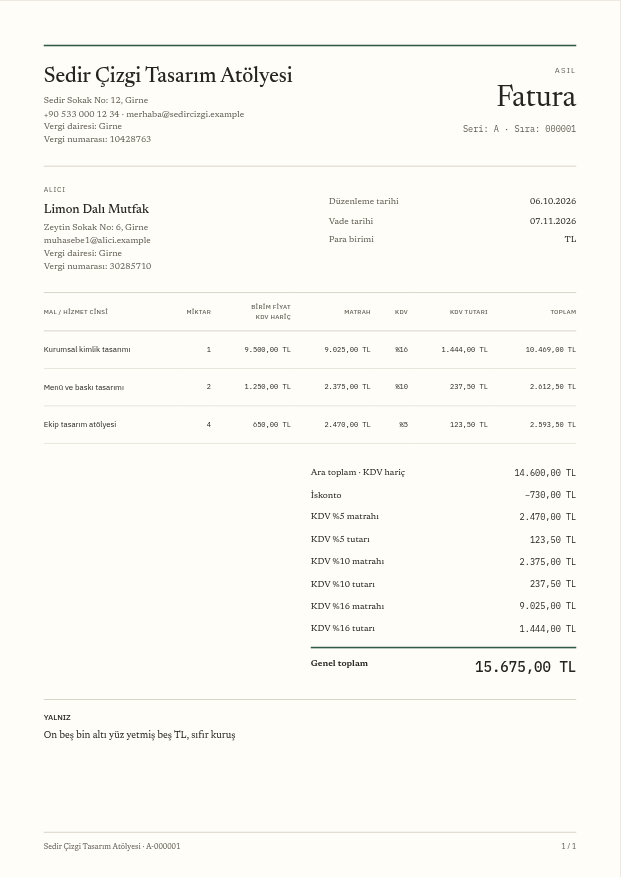
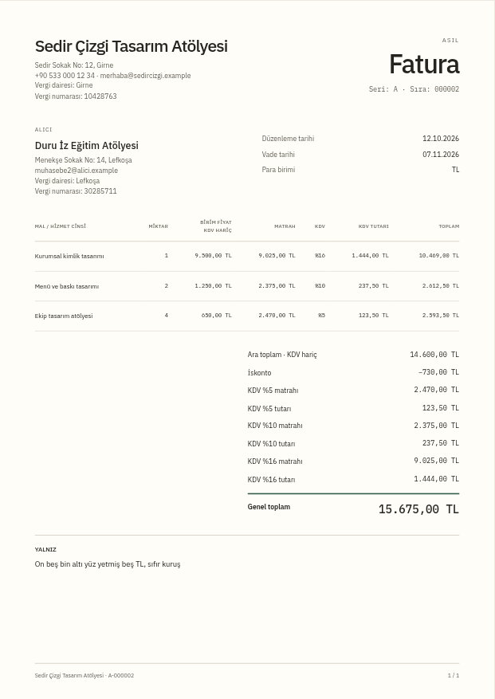
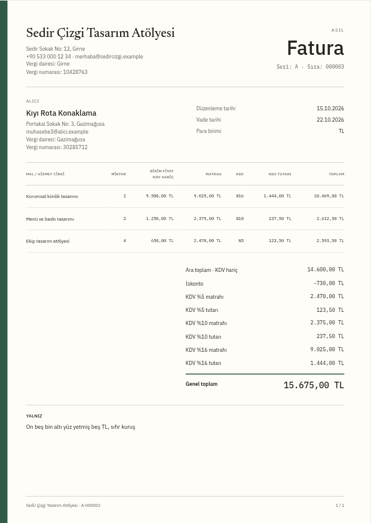
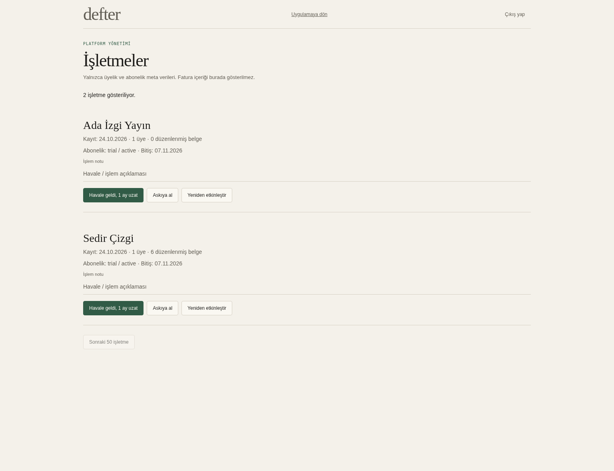

# Defter ekran görüntüleri

Bu galeri uygulamanın gerçek arayüzünden, yerel `demo-defter` emülatöründe alındı. Sedir Çizgi, Ada İzgi Yayın ve bütün alıcı bilgileri kurgusaldır. `.example` e-posta adresleri gerçek alıcılara ait değildir. Kalemlerdeki oranlar hesaplama örneğidir; güncel KKTC KDV tüzüğünün doğrulandığı anlamına gelmez.

[Üretim kurulum durumu](../firebase-production.md) ayrı takip edilir. Bu görüntüler canlı ortamın kullanıma hazır olduğunu göstermez.

## Fatura oluşturma

Seri, düzenleme/vade tarihleri, satıcı-alıcı bilgileri ve aynı ekranda A4 önizleme.



## Kalemler ve hesaplama

Üç kalemde %5, %10 ve %16 KDV; %5 iskonto; oran bazında matrah ve KDV kırılımı; yazıyla toplam. Gösterilen fiyatlar KDV hariçtir. Genel toplam 15.675,00 TL’dir.



## Fatura geçmişi

Taslak, düzenlenmiş, ödenmiş, gecikmiş ve iptal belgeler aynı listede. Proforma ayrı P serisinde, yabancı para belgesi GBP olarak gösterilir. İptal belgenin numarası korunur.



## Aylık KDV özeti

Matrah, KDV ve toplamlar para birimlerine göre ayrılır. İptal faturalar ve proformalar bu özete girmez. CSV düğmesi aylık tabloyu dışa aktarır.



## Koyu tema

Arayüz koyulaşırken belge yazdırılacak kâğıt görünümünü korur.



## Mobil önizleme

390 piksel genişlikte Düzenle/Önizleme geçişi ve ölçeklenen belge. Görseli üreten akışta 360 piksel genişlikte yatay taşma olmadığı da kontrol edilir.



## Üç belge şablonu

Bunlar düzenlenmiş belgelerin uygulamadaki önizlemesinden alınmıştır. Aynı kalemler ve hesaplama, farklı şablonlarda sunulur.

| Klasik                                                                | Düz                                                             | Şerit                                                                                |
| --------------------------------------------------------------------- | --------------------------------------------------------------- | ------------------------------------------------------------------------------------ |
|  |  |  |

## Platform yönetimi

Platform yöneticisi işletmenin üye ve belge sayılarını, abonelik durumunu ve bitiş tarihini görür. Müşterilerin fatura içerikleri bu panelde yer almaz.



## Görselleri yeniden alma

Proje kökünde `npm ci` ve `npm --prefix functions ci` tamamlandıktan sonra bir terminalde:

```sh
npm run dev
```

Emülatörler hazır olduğunda başka bir terminalde:

```sh
npm run screenshots
```

Akış yalnızca localhost ve `demo-defter` kullanır. Kurgusal hesap, iki işletme ve yedi belge oluşturur; düzenleme, ödeme ve iptal işlemlerini gerçek yerel Functions üzerinden çalıştırır. Önceki görsel çekiminin kayıtları emülatörden temizlenir. Canlı Firebase projesine veya gerçek kullanıcılara yazmaz. Çıktılar bu klasördeki PNG dosyalarını günceller.
